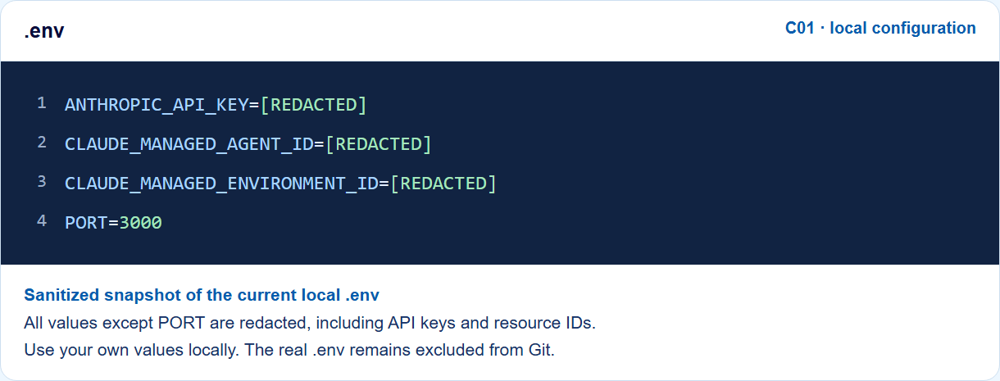

# Claude Managed Agents session lab

This local app creates and observes Claude Managed Agents sessions. It streams session events, displays stop reasons, and lets you interrupt work or respond to tool actions.

The separate [student guide](https://github.com/luiscoco/Udemy-claude-managed-agents-lesson-c01-app/blob/main/public/guide.html) includes **What you will learn** with six learning goals and **How to run this application** with numbered setup and first-run instructions. Navigation buttons on both pages link the learning goals, run instructions, and [session lab](https://github.com/luiscoco/Udemy-claude-managed-agents-lesson-c01-app/blob/main/public/index.html). Both pages share the same light/dark preference. These repository links open source files on GitHub. Follow the setup instructions below to view the running pages locally.

After visiting the guide in the same browser tab, the app restores your last session ID. Click **Connect** to view its events again. Visiting the guide does not stop remote work or submit another prompt.

The [Architecture & workflow page](https://github.com/luiscoco/Udemy-claude-managed-agents-lesson-c01-app/blob/main/public/architecture.html) shows a UML sequence infographic with five participants and 21 numbered messages, followed by a walkthrough of the actual routes and optional action/interrupt branches. It uses the application palette and large text. View the [SVG](https://github.com/luiscoco/Udemy-claude-managed-agents-lesson-c01-app/blob/main/public/architecture.svg) or [PNG](https://github.com/luiscoco/Udemy-claude-managed-agents-lesson-c01-app/blob/main/public/architecture.png) in the repository. Regenerate the editable SVG with `python scripts/build-sequence-diagram.py`; the optional `scripts/preview-student-guide.py` script renders its PNG using Python Playwright.

Every walkthrough step and optional branch includes source-labelled code excerpts and explanations. Refresh these excerpts from `server.js` and `public/app.js` with `python scripts/build-walkthrough-snippets.py`. The displayed snippets are excerpts of the actual handlers; use the source files for their complete surrounding logic.

The architecture page starts with a **Step 0** prerequisite walkthrough: configure the API key, create or reuse an agent and environment, save the printed IDs in `.env`, and start the app. It includes actual excerpts from `scripts/create-agent.js` and `scripts/create-environment.js`. Resource creation is setup work; it is not repeated for every conversation.

## Before you start

You need:

- Node.js 20 or later and npm. Check your installation in a terminal with `node --version` and `npm --version`.
- An Anthropic API key for a workspace with access to Managed Agents.
- The IDs of an existing managed agent and environment in that workspace. The app does not create these resources.

## Create your local .env file

Run these commands from the application folder containing `package.json`:

```powershell
npm install
if (!(Test-Path .env)) { Copy-Item .env.example .env }
```

Open `.env` in your editor. The filename must be exactly `.env`, not `.env.txt`. Keep any existing configuration instead of overwriting it.

```dotenv
ANTHROPIC_API_KEY=your_api_key
CLAUDE_MANAGED_AGENT_ID=your_agent_id
CLAUDE_MANAGED_ENVIRONMENT_ID=your_environment_id
PORT=3000
```

- `ANTHROPIC_API_KEY`: your workspace API key. Set this before running either resource-creation script.
- `CLAUDE_MANAGED_AGENT_ID`: an existing agent ID or the ID printed by `npm run create-agent`.
- `CLAUDE_MANAGED_ENVIRONMENT_ID`: an existing environment ID or the ID printed by `npm run create-environment`.
- `PORT`: the local server port. Use `http://127.0.0.1:3000` for the example above.

If you do not yet have the resource IDs, configure the API key first and follow the next section. Save the returned IDs into `.env`, then run `npm start`. Restart the server after editing `.env` so the host loads the new values. Keep the real file local; `.gitignore` excludes it while retaining `.env.example` for students.

### Sanitized snapshot of the current configuration

The image below was rendered from a sanitized copy of the current local `.env`. Every value except `PORT`, including resource IDs, is replaced before rendering. `[REDACTED]` is a documentation label, not a value to copy into your own configuration.



## Create an agent and environment

After running `npm install`, create `.env` as described above and set `ANTHROPIC_API_KEY` to your real key. The two ID values can remain placeholders for now. Your workspace needs Managed Agents access.

From the project folder, run this command to create an agent. It reads the API key from .env and prints the new agent ID:

```powershell
npm run create-agent
```

Copy the printed ID into `CLAUDE_MANAGED_AGENT_ID` in .env. If the model is unavailable to your workspace, choose a supported model in scripts/create-agent.js.

Next, create a cloud environment:

```powershell
npm run create-environment
```

Copy the printed ID into `CLAUDE_MANAGED_ENVIRONMENT_ID` in `.env`. This environment uses limited networking and allows package managers. Each command creates a new remote resource, so save the IDs and reuse them. If a command fails, check the error and your workspace access. These resources are created in your Anthropic workspace and may be subject to its terms and charges.

See Anthropic's [agent setup](https://platform.claude.com/docs/en/managed-agents/agent-setup) and [cloud environment setup](https://platform.claude.com/docs/en/managed-agents/environments) documentation for more options.

## Run the app

1. Open a terminal in this project folder (the folder containing `package.json`). Install the dependencies:

   ```powershell
   npm install
   ```

2. Create your local configuration file. In PowerShell, run:

   ```powershell
   if (!(Test-Path .env)) { Copy-Item .env.example .env }
   ```

3. Open `.env` in your editor and replace the placeholder values with your own credentials and IDs:

   ```dotenv
   ANTHROPIC_API_KEY=your_actual_api_key
   CLAUDE_MANAGED_AGENT_ID=your_actual_agent_id
   CLAUDE_MANAGED_ENVIRONMENT_ID=your_actual_environment_id
   PORT=3000
   ```

   Keep the API key private. The `.env` file is excluded from Git. If you change `.env` while the server is running, restart the server to load the new values.

4. Start the server:

   ```powershell
   npm start
   ```

   Alternatively, use `npm run dev`. Both commands start the same server.

5. Open `http://127.0.0.1:3000` in your browser. If you changed `PORT`, use that port in the address instead.

6. Click **New session**, enter a message, and click **Send message**. The activity feed shows the agent's messages and session events. To reconnect to an existing session, enter its session ID and click **Connect**.

To stop the local server, press **Ctrl+C** in the terminal. Closing the browser or stopping the local server does not stop remote agent work. To request a stop, click **Interrupt work**, then wait for an idle event or use **Inspect session** to confirm the remote state.

## Session behavior

New sessions have a 50-cent USD list-cost budget. Anthropic enforces the cap between model requests, so the final cost can exceed it slightly. The app opens the live stream before sending messages; on reconnect it opens a stream, fetches history, and deduplicates events by ID.

A `requires_action` stop may include multiple event IDs. Inspect the event details before allowing or denying a tool call, or supply a result for a custom tool. This app does not execute custom tools automatically. Inspect any artifacts separately; an agent message alone does not verify that a file was saved.

## Try the human-in-the-loop panel

The default `create-agent` script does not define a custom tool or require confirmation for its built-in tools, so an ordinary conversation may never use this panel. For a reproducible demonstration, create a **separate** agent:

```powershell
npm run create-pending-demo-agent
```

Save your current `CLAUDE_MANAGED_AGENT_ID` first, then replace it in `.env` with the ID printed by the command and restart the server. Keep the existing environment ID. Each run creates a new remote agent; save and reuse its ID. Sessions use the existing 50-cent budget and API usage can incur charges. To return to the original agent, restore its ID and restart the server.

The demo script defines `get_demo_fact`, a custom tool whose result must be supplied by the application, and sets the built-in toolset's permission policy to `always_ask`. These are two different mechanisms:

1. **Custom result:** Click **New session** and send `Use get_demo_fact to get a demo fact about Mars.` Wait for `requires_action`. Open the `agent.custom_tool_use` event in the feed and inspect its ID and input. The first pending ID is filled in automatically; if there are multiple pending events, select the matching ID yourself. Enter `Mars is known as the Red Planet.` in **Custom tool result** and click **Send result**. The agent can then use that supplied text to continue. The text is a demonstration result entered by the student; the app does not look up the fact automatically.
2. **Approval:** Create another session and send `Use the bash tool to run exactly: printf 'Hello from the approval demo'`. Wait for `requires_action`, inspect the `agent.tool_use` event and its requested command, and click **Allow** to run it. Alternatively, click **Deny** to decline it. Only approve commands you have inspected. The custom-result button is not an approval button.

`public/app.js` fills the first pending ID from `session.status_idle` and sends the selected response to `POST /api/sessions/:id/action`. In `server.js`, **Send result** becomes a `user.custom_tool_result` with `custom_tool_use_id` and the supplied text. **Allow** and **Deny** become a `user.tool_confirmation` with `tool_use_id` and the chosen result. The server sends the event to Anthropic; subsequent agent and status events appear in the activity feed. See Anthropic's [event documentation](https://platform.claude.com/docs/en/managed-agents/events-and-streaming) and [permission policies](https://platform.claude.com/docs/en/managed-agents/permission-policies).

## Troubleshooting

- **Configuration message:** Check that `.env` exists in the project folder, contains all three values, and that you restarted the server after editing it.
- **API or session error:** Check the API key, agent ID, environment ID, and Managed Agents access for your Anthropic workspace. The activity feed and error notice provide details returned by the API.
- **Port already in use (`EADDRINUSE`):** An app is already listening on that port. In PowerShell, find the listening process ID (PID):

  ```powershell
  netstat -ano | findstr :3000
  ```

  Look for the `LISTENING` line; its last column is the PID. If it is a server you started in another terminal, stop it there with **Ctrl+C**. You can identify a process by replacing `<PID>` with that number:

  ```powershell
  Get-Process -Id <PID>
  ```

  Then restart this app with `npm run dev` and open `http://127.0.0.1:3000`. Alternatively, set `PORT=3001` in `.env`, start the app, and open `http://127.0.0.1:3001`.

- **Check the code:** Run `npm test` to check the server and browser JavaScript syntax. This does not test a live Anthropic session.

The server listens on localhost and is intended for a trusted local user, not public deployment.

## What students learn

This app demonstrates the agent loop and the division between the hosted session and the application: create a session, send messages, observe live events, reconnect to persisted history, and respond to actions. Your host retains responsibility for user authorization and business decisions.

## How the app was developed

1. The Node server loads the API configuration and creates a Managed Agents client. Credentials remain on the server.
   ```js
   const client = new Anthropic({ apiKey: process.env.ANTHROPIC_API_KEY });
   ```
2. The session endpoint references an existing agent and environment and sets a list-cost budget.
   ```js
   const session = await client.beta.sessions.create({
     agent: process.env.CLAUDE_MANAGED_AGENT_ID,
     environment_id: process.env.CLAUDE_MANAGED_ENVIRONMENT_ID,
     budget: { type: "limit", max_list_cost: { amount: "50", currency: "USD" } },
   });
   ```
3. The server opens an event stream and lists recorded events, deduplicating by ID before forwarding them to the browser. Opening the stream first helps avoid missing events while history is loaded.
   ```js
   const stream = await client.beta.sessions.events.stream(id);
   for await (const event of client.beta.sessions.events.list(id)) emit(state, event);
   ```
4. The browser submits messages to the local server; the server sends a `user.message` event and displays resulting activity. The action panel allows the learner to respond to supported requests.
   ```js
   await client.beta.sessions.events.send(id, {
     events: [{ type: "user.message", content: [{ type: "text", text: data.text.trim() }] }],
   });
   ```
